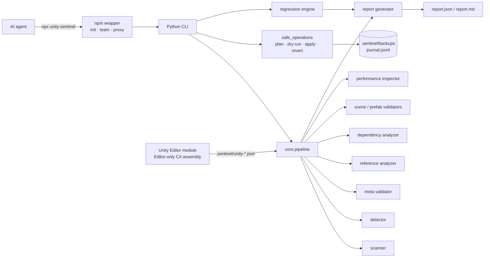

# UNITY SENTINEL

**Your AI Unity Engineering Guardian.**

An open-source **agent skill + verification toolkit** that teaches AI coding
agents (Claude Code, OpenAI Codex, Cursor, custom agents) how to change existing
Unity projects *safely* — and gives them the instruments to prove it.

[](LICENSE)
[](pyproject.toml)

```bash
npx unity-sentinel init --agents all --team
npx unity-sentinel scan --project . --baseline
```

---

## The problem

An AI agent can write plausible Unity code in seconds. What it usually cannot do
is answer three questions that actually matter:

1. **What is in this project?** Unity version, render pipeline, assemblies,
   serialised assets, `.meta` state.
2. **What exactly will my change touch?** Scenes, prefabs and ScriptableObjects
   are serialised graphs — references break silently.
3. **Did the change make things worse?** Without a baseline, "it compiles" is not
   evidence.

UNITY SENTINEL is built around a single principle: **understand → plan → confirm
→ apply minimally → verify → report honestly.** It never declares success for a
check that did not run.

## What it does

| Capability | Command | Status |
| --- | --- | --- |
| Project map: root, Unity version, packages, render pipeline, file inventory | `scan` | implemented |
| Generated-directory exclusions (`Library/`, `Temp/`, `Obj/`, `Logs/`, `Builds/`) | `scan` | implemented |
| `.meta` integrity: missing / orphan / invalid / **duplicate GUID** | `meta-check` | implemented |
| Unknown GUID references in text assets (with explicit limitations) | `references` | implemented |
| Assembly definition graph + cycle detection | `scan` | implemented |
| File-level scene/prefab structural checks (Missing Script markers, duplicate fileIDs) | `scan` | implemented |
| Heuristic performance smells (labelled as heuristics, never errors) | `scan` | implemented |
| Plan / dry-run / hash-locked apply / backup / journal / revert | `plan`, `apply`, `revert` | implemented |
| Regression comparison against a baseline | `verify` | implemented |
| JSON + Markdown reports with secret redaction | `scan`, `report` | implemented |
| Agent adapters: Claude Code, Codex, Cursor, generic | `init` | implemented (see status matrix) |
| Six-role agent team (scout … reporter) | `init --team` | implemented |
| Synthetic benchmark with precision/recall/F1 | `benchmark` | implemented |
| Unity Editor module: real scene/prefab validation, NUnit import | `unity/` | implemented, **not compiled in CI** (no Unity available) |
| Unity EditMode test execution | – | outside this tool: use `Unity -runTests` |
| Compiling arbitrary C# / running gameplay code | – | **not supported by design** |

Everything labelled "implemented" has tests. Nothing labelled "not supported" is
simulated.

## Architecture



Details: [`docs/architecture.md`](docs/architecture.md).

## Quick start

```bash
# 1. Install into your Unity project
cd /path/to/UnityProject
npx unity-sentinel init --agents all --team

# 2. Check the environment (Python, Git, dotnet, Unity)
npx unity-sentinel doctor

# 3. Baseline scan — read-only
npx unity-sentinel scan --project . --baseline

# 4. Let the agent plan a change
npx unity-sentinel plan --project . --changes .sentinel/changes.json

# 5. Inspect the diff, then apply
npx unity-sentinel apply --project . --plan .sentinel/plan.json \
  --changes .sentinel/changes.json --dry-run --show-diff
npx unity-sentinel apply --project . --plan .sentinel/plan.json \
  --changes .sentinel/changes.json --yes

# 6. Verify and report
npx unity-sentinel verify --project .
```

From a clone, the same commands are `python3 scripts/sentinel.py <command>`.

> `npx unity-sentinel` works once the package is published to npm. Right now use
> `npx github:ssrinfree-hash/unity-sentinel ...` — see
> [`docs/installation.md`](docs/installation.md).

## Example output

```text
$ python3 scripts/sentinel.py scan --project tests/fixtures/broken_meta
UNITY SENTINEL v1.0.0 — mode: scan
Status: FAIL
Findings: 3 (critical 0, error 1, warning 2, info 0)
Unity: 2022.3.20f1
Environment: python 3.13.16, git=yes, dotnet=no, unity=no
  [WARNING] META_MISSING Assets/Scripts/OrphanAsset.cs — Asset has no .meta file; Unity will generate a new GUID on import.
  [WARNING] META_ORPHAN Assets/Scripts/Ghost.cs.meta — Orphan .meta file without a corresponding asset.
  [ERROR] META_INVALID Assets/Scripts/BrokenMeta.cs.meta — Meta file has no parsable 32-character hexadecimal guid.
Skipped checks: unity.editor_checks, unity.tests
Report: /tmp/out/report.json
        /tmp/out/report.md
```

A full sample report: [`examples/sample_report.md`](examples/sample_report.md)
and [`examples/sample_report.json`](examples/sample_report.json)
(synthetic demo data).

## Connect your agent

| Agent | Command | Integration |
| --- | --- | --- |
| Claude Code | `init --agents claude` | `.claude/skills/unity-sentinel/SKILL.md` |
| OpenAI Codex | `init --agents codex` | `AGENTS.md` snippet + `.sentinel/agents/codex/` |
| Cursor | `init --agents cursor` | `.cursor/rules/unity-sentinel.mdc` |
| Generic | `init --agents generic` | `.sentinel/agents/generic/` |

All adapters share one policy file (`SKILL.md`). Integration status — including
what was **not** verified — is documented in
[`docs/agent-compatibility.md`](docs/agent-compatibility.md).

## Requirements

* **Python 3.10+** — the toolkit uses the standard library only, no `pip install`
  needed.
* **Node.js 18+** — only for the `npx` installer/proxy.
* **Git** — recommended (diff-friendly reports, status detection).
* **Unity 2021.3 LTS+** — only for the Editor module; every file-based check works
  without Unity.

## Testing

```bash
python3 -m unittest discover -s tests -t .     # 139 tests: unit + integration
python3 scripts/sentinel.py benchmark          # synthetic benchmark
node npm/test/smoke.test.js                    # npm wrapper
```

The suite covers path traversal, symlink escapes, dry-run immutability, hash
locking, backup/journal integrity, revert safety, secret redaction, Unicode paths,
CLI exit codes and the full scan → plan → apply → verify → report cycle.

## Limitations (read before trusting a green status)

* Not a Unity Editor, compiler or test framework. It does not execute gameplay
  code.
* Scene/prefab **reference resolution** requires the Editor module; without Unity
  those checks are reported as `SKIPPED`, and the status becomes
  `NOT VERIFIED` rather than `PASS`.
* `REF_UNKNOWN_GUID` is a *warning with medium confidence* — the GUID may belong
  to a package or engine asset.
* Reflection, `Resources.Load`, Addressables and binary-serialised assets are
  invisible to GUID scanning.
* Performance findings are heuristics, never profiler measurements.
* The Unity C# module was reviewed but **not compiled** in this repository
  (no Unity installation available). See
  [`docs/unity-integration.md`](docs/unity-integration.md).
* An empty finding list means *no known issue was detected* — not proof of
  correctness.

## Security

* No network calls, no telemetry, no hidden data collection.
* Credential-like files (`.env`, `*.pem`, `*.key`, `*credential*`) are never read
  for content and never hashed.
* Tokens and absolute paths are redacted from every report.
* All writes go through one audited module with containment checks, symlink
  guards, hash locks, backups and a journal.
* Report a vulnerability privately — see [`SECURITY.md`](SECURITY.md).

## Contributing

Read [`CONTRIBUTING.md`](CONTRIBUTING.md) and
[`CODE_OF_CONDUCT.md`](CODE_OF_CONDUCT.md). Bug reports and fixtures for real
failure modes are especially welcome — a reproducible fixture is worth more than
a paragraph of description.

## License

MIT — see [`LICENSE`](LICENSE).

## Project structure

```
SKILL.md            agent policy (the heart of the project)
README.md
core/               Python analysis core (stdlib only)
scripts/sentinel.py CLI
unity/              Editor-only C# module + EditMode tests
agents/             Claude Code / Codex / Cursor / generic adapters
npm/                npx installer + agent team
tests/              unit + integration tests + synthetic fixtures
benchmark/          synthetic benchmark + ground truth
docs/               architecture, safety, commands, troubleshooting, …
config/             default JSON configuration
examples/           sample reports and workflow snippets
```
