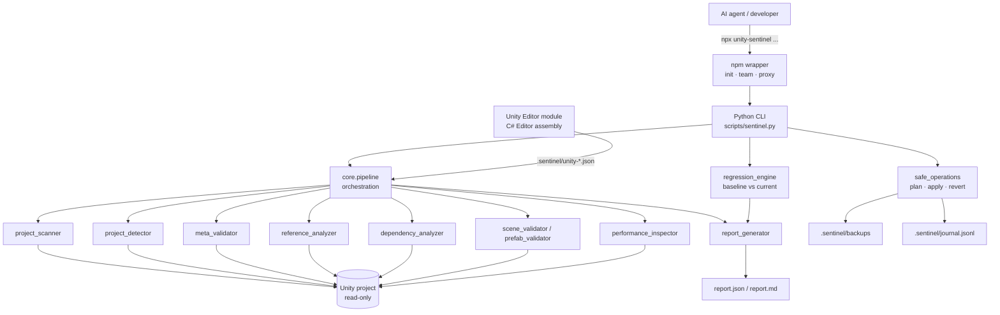

# Architecture

UNITY SENTINEL is a thin, auditable layer between an AI agent and a Unity
project. Every component has one job, and every check produces evidence.



## Layers

### 1. `core/` — deterministic Python core

| Module | Responsibility | Writes? |
| --- | --- | --- |
| `models.py` | dataclasses, severities, confidence, status derivation | no |
| `paths.py` | root resolution, containment, symlink guards, secret heuristics | no |
| `config.py` | JSON config merged over safe defaults | no |
| `project_detector.py` | Unity version, packages, render pipeline, platforms | no |
| `project_scanner.py` | file inventory, generated-dir exclusions, limits | no |
| `meta_validator.py` | `.meta`/GUID integrity | no |
| `reference_analyzer.py` | unknown GUID references in text assets | no |
| `dependency_analyzer.py` | asmdef graph, cycle detection, duplicate class names | no |
| `unity_yaml.py` | line-oriented Unity YAML helpers | no |
| `scene_validator.py` / `prefab_validator.py` | structural anomalies | no |
| `performance_inspector.py` | heuristic code smells | no |
| `regression_engine.py` | baseline + hashes + comparison | baseline only (in `.sentinel/`) |
| `report_generator.py` | JSON/Markdown, redaction, path sanitisation | report files |
| `safe_operations.py` | the **only** writer of project files | yes, guarded |
| `pipeline.py` | orchestration, environment detection, baseline flow | via the above |

### 2. `scripts/` — CLI

`scripts/sentinel.py` is a thin argparse front end: it parses arguments, calls
`core.pipeline`, prints a summary and maps the report status to an exit code.
All logic lives in `core/`, which is why the integration tests can exercise the
same code path without spawning processes.

### 3. `unity/` — Editor-side module (C#)

An Editor-only assembly (`includePlatforms: ["Editor"]`) that uses
`AssetDatabase`, `EditorSceneManager`, `PrefabUtility` and
`GraphicsSettings.currentRenderPipeline` to do what file parsing cannot. It
writes JSON into `.sentinel/` for the Python report to consume and never saves
scenes or prefabs.

### 4. `npm/` — installer and command proxy

Installs the skill, agent adapters and agent team into a project, copies the
Python toolkit into `.sentinel/toolkit/`, and forwards verification commands to
Python. It contains no analysis logic of its own.

## Data flow of a change

```
scan --baseline ──► .sentinel/baseline.json   (findings + SHA-256 of tracked files)
        │
changes.json ──► plan ──► .sentinel/plan.json (paths, reasons, sha256_before)
                                │
                    apply --dry-run ──► unified diff (no writes)
                                │
                    apply --yes ──► backup + atomic write + journal entry
                                │
                    verify ──► compare(baseline, current) ──► REGRESSION_* findings
                                │
                    report.json / report.md
```

## Design decisions

1. **No third-party Python dependencies.** Analysis uses the standard library
   only, so the toolkit can be vendored into a project and audited quickly.
2. **Findings are data, not prose.** Stable `code`s let agents diff runs and let
   CI fail on specific codes.
3. **Confidence is explicit.** Deterministic facts are `high`; structural
   signals `medium`; heuristics `low`. Nothing heuristic is reported as an error.
4. **Status is derived, not asserted.** `PASS` requires that mandatory checks
   actually ran; a skipped editor-side check turns the status into
   `NOT VERIFIED` rather than a false success.
5. **One writer.** All writes funnel through `safe_operations` so the safety
   rules are testable in isolation.
6. **Unity does Unity things.** Anything requiring the Editor is delegated to the
   Editor module instead of re-implementing YAML semantics.

## Extension points

* **New check** — add a module with a `validate_*` function returning
  `list[Finding]`, register it in `core/pipeline.run_analysis`, add a test and a
  benchmark entry.
* **New agent adapter** — add `agents/<name>/{README,instructions}.md` and an
  entry in `npm/lib/agents.js`.
* **New Editor check** — add a validator in `unity/Editor/`, expose it in
  `SentinelMenu` and cover it in `unity/Tests/Editor`.
